  

  &nbsp;
  &nbsp;
  

 

  Hi, I'm İzzet 👋🏻 I'm a full-stack developer who likes owning the whole path of a product, 
  from the first sketch to the server it runs on.

  <b>End to end.</b> I design the interface, build the API behind it and deploy it myself. 
  <b>Tested before it ships.</b> Unit tests, end-to-end tests and a CI pipeline that has to go green first. 
  <b>Always tinkering.</b> When I'm not building for the web, I'm running my homelab, 
  writing firmware for tiny gadgets or reworking my Linux desktop for the hundredth time.

If you're building something interesting, I'd love to hear about it.

 

  

  

